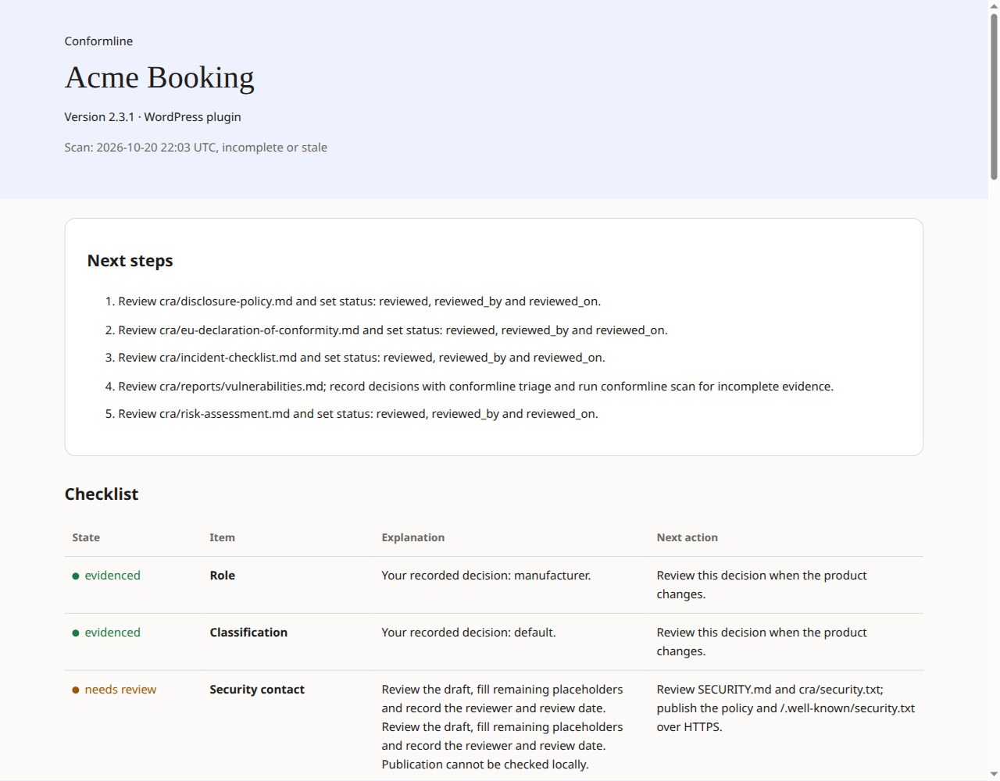
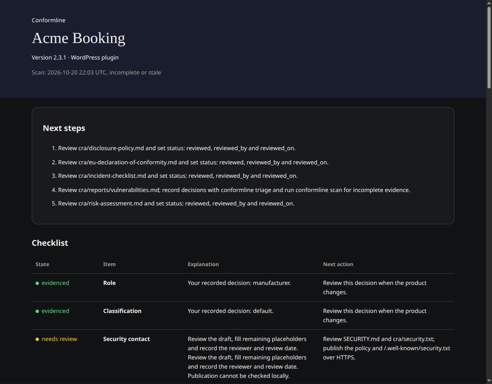

# Conformline

Prepare your EU Cyber Resilience Act evidence and see what still needs doing.

Conformline checks the third-party components in your software release,
writes draft evidence documents, and shows what still needs your review.
It starts with WordPress plugins and themes, Composer packages and npm packages.

## Start with your coding agent

Copy this into Claude Code, Codex or another coding agent in your product:

```text
Get this project ready for the EU Cyber Resilience Act with Conformline.
Use https://github.com/vincentsch/conformline: read its AGENTS.md and follow
the steps. Ask me the questions only I can answer, and show me what is still
missing at the end.
```

The agent follows [AGENTS.md](AGENTS.md), shows the inventory first, and asks
about your role, contact, support period and product categories. You can leave
answers unknown. With an existing `cra.yml`, it uses your saved answers and
runs the release check directly.

The first public release is being prepared. The public prompt and downloads
need the repository and release to be public. Source contributors can build
locally using [CONTRIBUTING.md](CONTRIBUTING.md).

## Install and try the example

After publication, install the checked release with Bash on Linux or macOS:

```bash
curl -fsSL https://raw.githubusercontent.com/vincentsch/conformline/main/install.sh -o install.sh
bash install.sh
conformline --version
conformline doctor
conformline demo
```

See [installation](docs/install.md) for PATH, pinned versions, Go installation
and native Windows downloads. If no release is available, the installer says
so. Doctor checks setup and provider connections; a missing profile is normal
before init. The demo uses a bundled fictional plugin in a new directory.

To try without vulnerability lookups:

```bash
conformline demo --offline --out ./example
```

Offline runs exit 11 and keep incomplete evidence visible. Open the printed
`status.html` path in your browser and `cra/README.md` for drafts and reports.





## Start on your plugin

From your plugin root, point init at the ZIP or folder you ship:

```bash
conformline init --release ../dist/plugin.zip
```

Init shows what it found before the interview. Composer runtime packages,
npm dependencies and recognised bundled JavaScript libraries form the
[inventory](docs/inventory.md). The release file tells the tool what ships;
build tools that stay outside it do not become shipped dependencies.
Without a release, some shipping decisions remain unknown.

Init writes `cra.yml`, draft documents in `cra/`, a root `SECURITY.md`, and
reports in `cra/reports/`. Complete and review the drafts yourself.
It refuses to replace an existing profile. On later releases, run each command
even when scan returns the expected incomplete-evidence code 11:

```bash
conformline scan --release ../dist/plugin.zip
conformline docs
conformline check
```

A saved `product.release` is used when you omit `--release`. Keep it current.
Docs preserves existing maker documents and refreshes the index. Check writes
Markdown and HTML status pages. Exit 10 means a policy failure; 11 means
incomplete evidence without a policy failure. Exit 0 does not mean every draft
has been reviewed. See [all status rules](docs/status-items.md).

A full captured offline demo check (20 October 2026 UTC):

```text
Conformline  Acme Booking 2.3.1 (WordPress plugin)   scan: 2026-10-20 22:13 UTC, incomplete or stale

Next
  1. Review cra/disclosure-policy.md and set status: reviewed, reviewed_by and reviewed_on.
  2. Review cra/eu-declaration-of-conformity.md and set status: reviewed, reviewed_by and reviewed_on.
  3. Review cra/incident-checklist.md and set status: reviewed, reviewed_by and reviewed_on.

Status
  evidenced      Role, Classification
  needs review   Security contact, Disclosure policy, SBOM, Known
                 vulnerabilities, Support period, User information, Risk
                 assessment, Technical documentation, EU declaration of
                 conformity, Incident readiness
  not applicable Open incidents (none)

Review the SBOM: scan evidence or product version is incomplete or stale. Run conformline scan.
The last scan is incomplete. Offline scan: vulnerability lookups have not run. Run conformline scan.

Full status: cra/reports/status.html
Not legal advice. Conformline helps you prepare; the decisions and the signature are yours.
```

The demo supplies fictional decisions. On your product, unknown decisions
stay visible until you make them.

## Keep it in your release routine

Commit your decisions and reviewed documents with your product. Build the
release first, scan it, review [findings](docs/vulnerabilities.md), then run
check. The [GitHub Action](docs/github-action.md) runs the saved-profile checks
on Ubuntu and keeps reports even when the evidence needs attention.

For an actively exploited vulnerability or severe incident, use the
[incident commands](docs/incidents.md). They record your awareness time,
show reporting deadlines and prepare drafts. A person checks the live ENISA
form, files the report and records the submission. Conformline does not file it.

## Read the guides

| Guide | What it explains |
| --- | --- |
| [CRA for plugin makers](docs/cra-for-plugin-makers.md) | Roles, dates and evidence obligations. |
| [Status items](docs/status-items.md) | Thirteen items, next actions and exit codes. |
| [Inventory](docs/inventory.md) | Detection, release boundaries and coverage gaps. |
| [Vulnerabilities](docs/vulnerabilities.md) | Sources, triage and product-specific VEX decisions. |
| [Documents](docs/documents.md) | Drafts, review and publication. |
| [Incidents](docs/incidents.md) | Awareness, deadlines and manual reporting. |
| [GitHub Action](docs/github-action.md) | Release checks, permissions and failure policy. |
| [cra.yml](docs/cra-yml.md) | Saved answers, manual components and unknowns. |
| [Commands](docs/commands.md) | Generated command and flag reference. |

## Privacy and limits

Online scans send package names and exact versions to OSV.dev, then fetch
advisory details and download CISA's Known Exploited Vulnerabilities catalog.
Those names and versions can reveal private product dependencies. Source code
and maker answers are not uploaded by Conformline. Doctor sends an empty OSV
request and checks KEV headers. Offline scan/demo/init skip those lookups.
Installation downloads the installer, binaries and checksums from GitHub;
Go installation uses Go's configured module services. Your coding agent has
its own network and privacy settings.

Reports credit [OSV](https://osv.dev/), the
[GitHub Advisory Database](https://github.com/advisories) (CC-BY 4.0), and
[CISA KEV](https://www.cisa.gov/known-exploited-vulnerabilities-catalog).
The status HTML is self-contained, with no external fonts or trackers.

Findings cover third-party components, not your own code. Zero findings cannot
prove the absence of vulnerabilities. Failed lookups and stale reports stay
incomplete. pnpm and Yarn lockfiles are detected but not parsed. Unrecognised
bundles, unknown versions and modified copies need your investigation.
There is no Go/Python dependency scan, container scan or notified-body procedure.
For open-source stewards, v0.1 runs the same checks but does not assess the
lighter Article 24 obligations.

Outputs are drafts. Conformline gives no legal advice. You make the decisions,
review the documents and sign any final declaration yourself.

As checked on **20 October 2026**, manufacturer reporting obligations under
Article 14 apply from **11 September 2026**; the main obligations apply from
**11 December 2027** (Article 71). Read the
[Commission overview](https://digital-strategy.ec.europa.eu/en/policies/cyber-resilience-act)
and the [CRA guide](docs/cra-for-plugin-makers.md) for scope and sources.

## License

[MIT](LICENSE). See [contributing](CONTRIBUTING.md) to work on Conformline itself.
